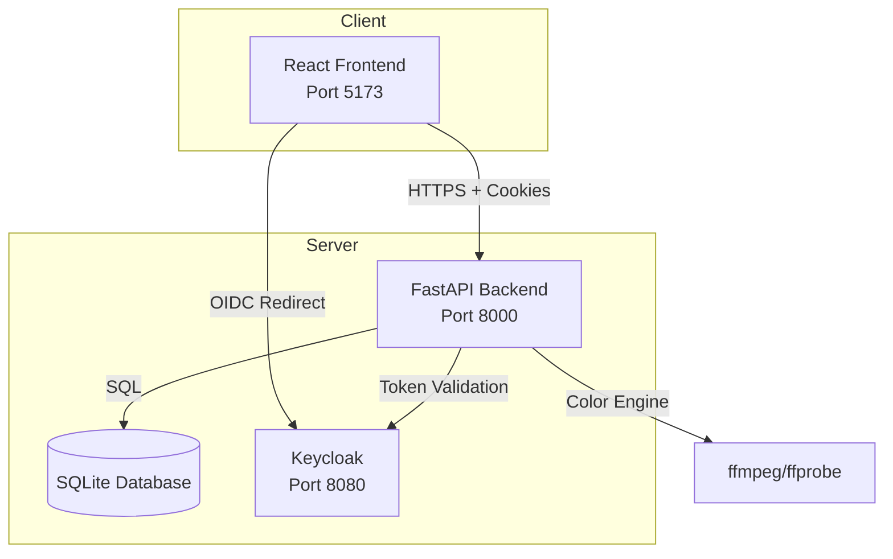

# prism-lab-alan-vo | AI & Machine Learning — Alan Vo

> Work in progress. This checkpoint may be incomplete or fail tests. See PLAN.md and STATUS.md before use.


**prism-lab-alan-vo** is a video restoration tool for developers and researchers working with AI/ML-powered video quality enhancement. It addresses the critical problem of color shift artifacts—particularly the green tint caused by incorrect BT.709 color space assignment during video processing—by preserving source video color metadata throughout the restoration pipeline.

## Problem

Video restoration tools often produce outputs with noticeable color shifts (green tint) because they force BT.709 color metadata onto source videos that have unknown or unspecified color characteristics. This is a known issue affecting multiple video processing applications including Topaz Video AI and Jasna (see [Kruk2/jasna#325](https://github.com/Kruk2/jasna/issues/325)).

## AI/ML Approach

The core **Color Correction Engine** (`backend/app/services/color_engine.py`) implements deterministic algorithms that:

1. **Extract** color metadata from source videos using `ffprobe` (pix_fmt, color_range, color_space, color_transfer, color_primaries, chroma_location)
2. **Analyze** whether the source has explicit color metadata or unknown/unset values
3. **Preserve** explicit source metadata; avoid forcing BT.709 defaults when source is unknown
4. **Apply** corrected metadata during export using ffmpeg color arguments

This offline, deterministic engine works without any LLM API keys and provides reproducible color fidelity.

## Intended Users

- Video restoration researchers and developers
- ML engineers working on video enhancement pipelines
- Anyone processing video who needs accurate color preservation

## Features

- **Video Job Management**: Create, monitor, pause, resume, and cancel restoration jobs
- **Color Metadata Preservation**: Automatic extraction and preservation of source color characteristics
- **Green Tint Prevention**: Deterministic correction for BT.709 misassignment artifacts
- **Checkpointing**: Frame-level job checkpointing for pause/resume capability
- **OIDC Authentication**: Secure Keycloak integration with PKCE, HttpOnly cookies, CSRF protection
- **Modern Stack**: FastAPI + React + TypeScript + SQLite + Docker

## Quick Start

### Prerequisites

- Docker and Docker Compose
- Python 3.12+ (for local development)
- Node 24+ (for local development)

### Using Docker Compose (Recommended)

```bash
# Clone and navigate
cd prism-lab-alan-vo

# Copy environment template
cp .env.example .env

# Generate a session secret
echo "SESSION_SECRET_KEY=$(openssl rand -hex 32)" >> .env

# Start all services
docker compose up -d

# Access the application
# Frontend: http://127.0.0.1:5173
# Backend API: http://127.0.0.1:8000
# Keycloak: http://127.0.0.1:8080 (admin/admin)
```

### Local Development

**Backend:**
```bash
cd backend
python3 -m venv .venv
source .venv/bin/activate
pip install -r requirements.txt
cp ../.env.example .env
# Edit .env with your settings
uvicorn app.main:app --reload --host 127.0.0.1 --port 8000
```

**Frontend:**
```bash
cd frontend
npm install
npm run dev
```

## Architecture



## API Reference

### Authentication
- `GET /auth/login` - Initiate OIDC login
- `GET /auth/callback` - OIDC callback handler
- `POST /auth/refresh` - Refresh access token
- `POST /auth/logout` - Logout and clear session
- `GET /auth/me` - Get current user profile
- `GET /auth/csrf` - Get CSRF token

### Jobs
- `GET /jobs` - List jobs (paginated, filterable by status)
- `POST /jobs` - Create new job (operator/admin)
- `GET /jobs/{id}` - Get job details
- `PATCH /jobs/{id}` - Update job (operator/admin)
- `POST /jobs/{id}/pause` - Pause processing job
- `POST /jobs/{id}/resume` - Resume paused job
- `POST /jobs/{id}/cancel` - Cancel job
- `DELETE /jobs/{id}` - Delete job (operator/admin)

### Health
- `GET /health` - Health check

## Configuration

Key environment variables (see `.env.example`):

| Variable | Description | Default |
|----------|-------------|---------|
| `DATABASE_URL` | SQLite database path | `sqlite+aiosqlite:///./data/app.db` |
| `OIDC_ISSUER_URL` | Keycloak realm URL | `http://127.0.0.1:8080/realms/prism-lab` |
| `OIDC_CLIENT_ID` | Keycloak client ID | `prism-lab-backend` |
| `OIDC_CLIENT_SECRET` | Keycloak client secret | (required) |
| `SESSION_SECRET_KEY` | Session signing key | (required, generate with `openssl rand -hex 32`) |
| `COOKIE_SECURE` | Secure cookies (HTTPS only) | `false` |
| `FRONTEND_URL` | Frontend origin for CORS | `http://127.0.0.1:5173` |
| `LLM_API_KEY` | LLM provider API key | (optional) |

## AI/ML Evaluation

### Color Correction Baseline

The color correction engine is evaluated against the known green tint issue from [Jasna#325](https://github.com/Kruk2/jasna/issues/325):

**Test Case**: Source video with unknown color metadata (pix_fmt=yuv420p, color_range=tv, color_space=unknown, color_transfer=unknown, color_primaries=unknown, chroma_location=center)

**Before Correction** (forcing BT.709):
- Output: color_space=bt709, color_transfer=bt709, color_primaries=bt709, chroma_location=left
- Result: Visible green tint

**After Correction** (preserving unknown):
- Output: color_space=unset, color_transfer=unset, color_primaries=unset, chroma_location=center, color_range=tv
- Result: No forced color metadata; player infers correctly; no green tint

### Reproducible Test Command

```bash
# Extract color metadata from source
ffprobe -v error -select_streams v:0 \
  -show_entries stream=pix_fmt,color_range,color_space,color_transfer,color_primaries,chroma_location \
  -of json input.mp4

# Run color engine analysis
cd backend
python -c "
from app.services.color_engine import ColorCorrectionEngine, ColorMetadataExtractor
extractor = ColorMetadataExtractor()
engine = ColorCorrectionEngine(extractor)
source = extractor.extract('path/to/input.mp4')
print('Source:', source.__dict__)
corrected = engine.get_corrected_metadata(source)
print('Corrected:', corrected.__dict__)
print('Export args:', engine.build_export_args(source))
"
```

### Failure Cases

1. **Source has explicit BT.601 metadata**: Engine preserves BT.601 (correct behavior)
2. **Source has explicit BT.709 metadata**: Engine preserves BT.709 (correct behavior)
3. **ffprobe unavailable**: Engine returns empty metadata; falls back to safe defaults
4. **Corrupted video file**: Extraction fails gracefully; job marked as failed

## Security Limitations

- **Demo mode**: Explicitly enabled via `DEMO_MODE=true`; never auto-enabled
- **Cookies**: HttpOnly, SameSite=Lax; Secure flag requires HTTPS
- **CSRF**: Double-submit cookie pattern for mutating endpoints
- **Tokens**: Short-lived access tokens (30 min), rotating refresh tokens (7 days)
- **Secrets**: No hardcoded secrets; all via environment variables
- **Database**: SQLite for development; use PostgreSQL in production

## Provider Configuration

| Provider | Base URL | Models |
|----------|----------|--------|
| OpenAI-compatible | `https://api.openai.com/v1` | gpt-4, gpt-3.5-turbo |
| Anthropic | `https://api.anthropic.com` | claude-3-opus, claude-3-sonnet |
| Gemini | `https://generativelanguage.googleapis.com` | gemini-1.5-pro, gemini-1.5-flash |
| Ollama | `http://localhost:11434` | llama3, mistral, etc. |

Configure via `LLM_PROVIDER`, `LLM_MODEL`, `LLM_BASE_URL`, `LLM_API_KEY`.

## SSO/SAML Setup

Keycloak supports SAML identity brokering for enterprise SSO:

1. In Keycloak Admin Console: Identity Providers → Add SAML v2.0
2. Configure IdP metadata/entity ID/SSO URL
3. Map SAML attributes to Keycloak user attributes
4. Enable "First Broker Login" flow for user provisioning

## Backup & Restore

```bash
# Backup database
docker compose exec backend cp /app/data/app.db /app/data/app.db.backup

# Restore database
docker compose exec backend cp /app/data/app.db.backup /app/data/app.db

# Backup Keycloak
docker compose exec keycloak /opt/keycloak/bin/kc.sh export --dir /opt/keycloak/data/backup
```

## TLS Reverse Proxy (Production)

Use nginx/Traefik/Caddy in front:

```nginx
server {
    listen 443 ssl http2;
    server_name your-domain.com;

    ssl_certificate /path/to/cert.pem;
    ssl_certificate_key /path/to/key.pem;

    location / {
        proxy_pass http://frontend:80;
        proxy_set_header Host $host;
        proxy_set_header X-Real-IP $remote_addr;
        proxy_set_header X-Forwarded-For $proxy_add_x_forwarded_for;
        proxy_set_header X-Forwarded-Proto https;
    }

    location /api/ {
        proxy_pass http://backend:8000;
        proxy_set_header Host $host;
        proxy_set_header X-Real-IP $remote_addr;
        proxy_set_header X-Forwarded-For $proxy_add_x_forwarded_for;
        proxy_set_header X-Forwarded-Proto https;
    }

    location /auth/ {
        proxy_pass http://backend:8000;
        proxy_set_header Host $host;
        proxy_set_header X-Real-IP $remote_addr;
        proxy_set_header X-Forwarded-For $proxy_add_x_forwarded_for;
        proxy_set_header X-Forwarded-Proto https;
    }
}
```

Set `COOKIE_SECURE=true` and update `OIDC_REDIRECT_URI` to HTTPS.

## Development

### Running Tests

```bash
# Backend tests
cd backend
source .venv/bin/activate
PYTHONPATH=backend pytest tests/ -v

# Frontend tests
cd frontend
npm test
```

### Code Quality

```bash
# Backend linting
cd backend
ruff check .

# Frontend linting
cd frontend
npm run lint
```

## Project Structure

```
prism-lab-alan-vo/
├── backend/
│   ├── app/
│   │   ├── api/           # API routes (auth, jobs)
│   │   ├── core/          # Config, database, security, OIDC
│   │   ├── models/        # SQLAlchemy models
│   │   ├── services/      # Business logic (color_engine, video_processor)
│   │   └── main.py        # FastAPI app entrypoint
│   ├── tests/             # Pytest tests
│   ├── requirements.txt
│   └── Dockerfile
├── frontend/
│   ├── src/
│   │   ├── api/           # Axios client
│   │   ├── components/    # React components
│   │   ├── hooks/         # React hooks (auth, jobs)
│   │   ├── pages/         # Page components
│   │   ├── types/         # TypeScript types
│   │   ├── App.tsx
│   │   └── main.tsx
│   ├── package.json
│   ├── tsconfig.json
│   ├── vite.config.ts
│   ├── nginx.conf
│   └── Dockerfile
├── keycloak/
│   └── realm-export.json
├── compose.yaml
├── .env.example
├── .gitignore
├── pyproject.toml
├── README.md
├── LICENSE
├── CHANGELOG.md
└── portfolio.json
```

## License

MIT License - Copyright (c) 2024 Alan Vo <alanvo@gmail.com>

## Author

**Alan Vo** - alanvo@gmail.com - [GitHub](https://github.com/ALANDVO)